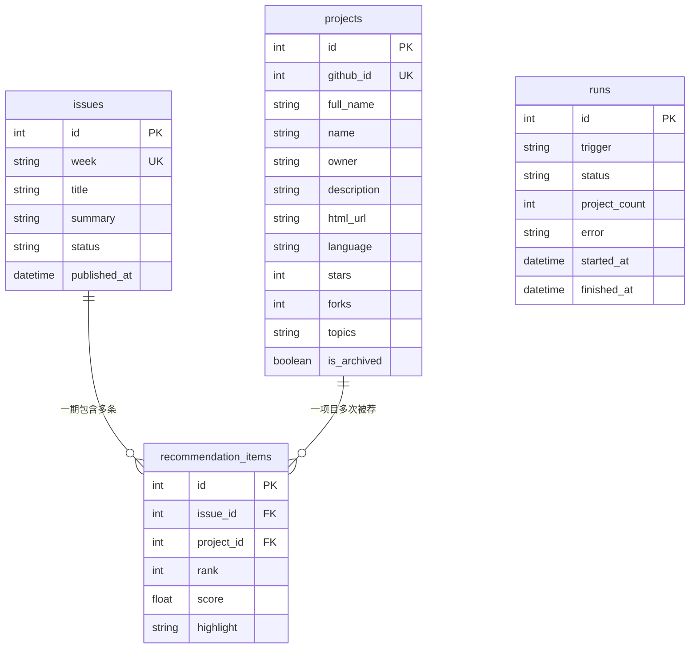

# GitHub 热门项目推荐 — 方案与计划

> 状态：待用户确认后开工（确认前不创建任何项目文件）

---

## 一、PRD（大白话版）

### 这是个什么东西
一个「每周自动从 GitHub 上挑出值得看的好项目，写成一篇中文推荐稿，再放到一个网页上」的小工具。

### 它解决什么问题
GitHub 上有几亿个仓库，普通人根本看不过来，很多好项目被埋没。这个工具就当你的「选品助手」，做四件事：

1. **抓取** — 定时从 GitHub 拉取最近热门 / 新出现的项目数据
2. **筛选** — 按规则过滤掉水项目、过气项目、刷星项目，留下真正值得推荐的
3. **写稿** — 根据筛选结果自动生成一篇推荐稿（每个项目配：名称、一句话简介、star 数、亮点、适合谁）
4. **展示** — 把稿子放到网页上供阅读

### 三大挑战 → 对策
| 挑战 | 对策 |
|------|------|
| 自动化 | 脚本一条龙跑完，无需手工 |
| 信息筛选 | 一套明确的评分 / 过滤规则 |
| 定时执行 | 云端定时（GitHub Actions）每周自动触发 |

### 目标用户
想追踪新技术、找好开源项目的自己与关注者，面向中文读者。

---

## 二、开发阶段（4 个）

### 阶段 1：MVP（最小可用，手动跑通）
抓取 + 筛选 + 生成 Markdown 稿 + 一个简单网页展示。

### 阶段 2：自动化 + 存档
接入 GitHub Actions 每周定时运行；历史稿子去重、归档，避免重复推荐。

### 阶段 3：内容质量提升
更聪明的筛选（趋势分析、分类标签、AI 摘要润色），让推荐更「有观点」。

### 阶段 4：体验优化
网页加搜索 / 分类 / 历史归档 / 订阅等，从「一份稿子」升级为「一个站点」。

---

## 三、MVP（第一版最小可用）应包含什么

一条**能手动跑通的最小闭环**，跑一次就能产出一篇推荐稿 + 一个网页：

1. **抓取脚本** — 调 GitHub Search API，按 star 数 + 近期创建时间拉取候选项目
2. **筛选脚本** — 按规则评分，过滤掉不合格的，选出 top 5~10
3. **生成脚本** — 输出一篇 Markdown 推荐稿，同时产出一份 JSON 数据（供网页用）
4. **展示网页** — TailwindCSS 单页，读取 JSON 渲染出推荐列表
5. **README** — 写清楚「怎么跑、怎么改」

> 定时自动化放阶段 2 再做。MVP 先保证「手动跑一次就能出结果」。

---

## 四、技术方案（简）

- **语言**：TypeScript（用 Node 跑脚本）
- **样式**：TailwindCSS（做展示网页）
- **数据源**：GitHub Search API（GitHub 官方没有 trending 接口，用搜索接口更稳定、免抓网页）
- **定时**：GitHub Actions cron（阶段 2 接入，免费云端、无需本地开机）

---

## 五、已确认决策

| 问题 | 决策 |
|------|------|
| 数据来源 | 官方 API 搜索（GitHub Search API） |
| 输出形态 | 网页（TailwindCSS）+ Markdown 稿，两者都要 |
| 定时平台 | GitHub Actions（每周云端自动触发） |
| 存储数据库 | SQLite（零配置单文件） |
| 前端方式 | 原生 HTML/JS + TailwindCSS（不引入框架） |

---

## 六、MVP 落地细节（技术）

### 目录结构（拟）
```
github-hot-recommend/
├── src/
│   ├── fetch.ts      # 调 Search API 拉候选项目
│   ├── filter.ts     # 评分/过滤，选 top 5~10
│   ├── generate.ts   # 生成 Markdown 稿 + data.json
│   └── types.ts      # 项目数据类型定义
├── public/
│   └── index.html    # TailwindCSS 展示页（读 data.json）
├── package.json      # tsx / 脚本命令
├── tsconfig.json
└── README.md         # 怎么跑、怎么改
```

### 关键实现点
1. **抓取**：`GET https://api.github.com/search/repositories`，query 用 `stars:>100 created:>YYYY-MM-DD` 之类条件，`sort=stars`；不登录每分钟限 10 次，够用。
2. **筛选**：过滤无 README / 已归档 / 刷星嫌疑；按 star 数、近 30 天增速等打分，取 top 5~10。
3. **生成**：Markdown 模板逐项目填充（名称 / 简介 / star / 语言 / 亮点 / 链接），同时导出 `data.json`。
4. **网页**：单页 `index.html`，TailwindCSS 卡片式列表，读取 `data.json` 渲染。
5. **定时**（阶段 2）：`.github/workflows/weekly.yml`，cron `每周一`，跑完后自动提交生成的稿子。

### 运行方式
```
npm install          # 装依赖
npm run build        # 抓取 + 筛选 + 生成
# 打开 public/index.html 看结果
```

---

## 七、完整设计文档（架构方案 + ER 图 + 路由表 + API 清单）

### 7.1 架构方案

整体是「采集 → 处理 → 存储 → 服务 → 展示」五层，外加一个「调度」横切面：

| 层 | 职责 | 技术 |
|----|------|------|
| 采集/处理层 | 抓 GitHub 数据、筛选、评分、生成稿子 | TypeScript 脚本 |
| 存储层 | 存项目、期次、推荐条目、执行记录 | SQLite |
| 服务层 | 提供 JSON 接口给前端 | Node.js + Express |
| 展示层 | 网页展示推荐内容 | TailwindCSS |
| 调度层 | 每周自动触发采集+生成 | GitHub Actions cron |

数据流向：GitHub Search API → 采集/处理 → SQLite → REST API → 前端网页；GitHub Actions 每周触发采集/处理。

### 7.2 数据模型 + ER 图

四张表：

- **projects** 项目（仓库快照）
- **issues** 期次（每周一期）
- **recommendation_items** 推荐条目（期次 ↔ 项目的多对多中间表）
- **runs** 执行记录（自动化运行日志）

关系：

- `issues` 1 ──< `recommendation_items` >── N `projects`（一期含多条，一个项目可被多期推荐）
- `runs` 独立日志表



**projects 字段**

| 字段 | 类型 | 说明 |
|------|------|------|
| id | int PK | 自增主键 |
| github_id | int UK | GitHub 仓库唯一 ID |
| full_name | string | owner/repo |
| name / owner | string | 仓库名 / 作者 |
| description | string | 简介 |
| html_url | string | 仓库链接 |
| language | string | 主语言 |
| stars / forks | int | 星数 / fork 数 |
| topics | string | 标签（JSON 数组） |
| is_archived | boolean | 是否已归档 |

**issues 字段**

| 字段 | 类型 | 说明 |
|------|------|------|
| id | int PK | 主键 |
| week | string UK | 期号，如 "2026-W43" |
| title / summary | string | 标题 / 导语 |
| status | string | draft / published |
| published_at | datetime | 发布时间 |

**recommendation_items 字段**

| 字段 | 类型 | 说明 |
|------|------|------|
| id | int PK | 主键 |
| issue_id | int FK | 属于哪一期 |
| project_id | int FK | 推荐哪个项目 |
| rank | int | 本期排序 |
| score | float | 评分 |
| highlight | string | 推荐理由/亮点 |

**runs 字段**

| 字段 | 类型 | 说明 |
|------|------|------|
| id | int PK | 主键 |
| trigger | string | manual / cron |
| status | string | running / success / failed |
| project_count | int | 本期抓到多少项目 |
| error | string | 失败原因（可空） |
| started_at / finished_at | datetime | 起止时间 |

### 7.3 路由表（前端页面）

| 路径 | 页面 | 说明 | 数据来源 |
|------|------|------|---------|
| `/` | 首页 | 最新一期推荐稿 | GET /api/issues（最新） |
| `/weekly` | 归档 | 所有历史期列表 | GET /api/issues |
| `/weekly/:week` | 期次详情 | 某一期推荐 | GET /api/issues/:week |
| `/projects` | 项目库 | 收录项目 + 筛选 | GET /api/projects |
| `/projects/:id` | 项目详情 | 单个项目 | GET /api/projects/:id |
| `/about` | 关于 | 站点说明 | 静态 |

### 7.4 API 清单

| 方法 | 路径 | 说明 | 参数 | 返回 |
|------|------|------|------|------|
| GET | `/api/health` | 健康检查 | — | `{ status: "ok" }` |
| GET | `/api/issues` | 期次列表 | `page` `limit` `status` | `Issue[]` + 总数 |
| GET | `/api/issues/:week` | 单期详情 | — | `Issue` + `items[]` + `projects[]` |
| GET | `/api/projects` | 项目库 | `q` `language` `sort` `page` | `Project[]` + 总数 |
| GET | `/api/projects/:id` | 项目详情 | — | `Project` |
| GET | `/api/stats` | 站点统计 | — | 期数/项目数/语言分布 |
| POST | `/api/refresh` | 手动触发抓取 | Header `X-API-Key` | `{ run_id }` |

### 7.5 技术栈（推荐）

| 部分 | 选型 | 理由 |
|------|------|------|
| 后端 | Node.js + TypeScript + Express | 生态最全、教程最多、新手友好 |
| 数据库 | SQLite（better-sqlite3） | 零配置单文件，GitHub Actions 里直接可用 |
| 前端 | TailwindCSS + 原生 HTML/JS | 已定 Tailwind，先不引入框架 |
| 采集 | GitHub Search API | 已定 |
| 定时 | GitHub Actions cron | 已定 |

### 7.6 与 MVP 的关系

- MVP（阶段 1）＝ 完整架构的「采集/处理 + 存储 + 最简 API + 单页前端」，先手动跑通。
- 阶段 2 接 GitHub Actions 定时 + 去重；阶段 3 内容质量；阶段 4 前端体验（搜索/归档/订阅）。

### 7.7 目录结构（拟，全栈版）

```
github-hot-recommend/
├── src/
│   ├── fetch.ts        # 采集：调 Search API
│   ├── filter.ts       # 筛选 + 评分
│   ├── generate.ts     # 生成 Markdown 稿 + 入库
│   ├── db.ts           # SQLite 连接与建表
│   ├── server.ts       # Express 入口（REST API）
│   └── types.ts        # 类型定义
├── public/
│   ├── index.html      # 首页（读 /api）
│   ├── weekly.html     # 期次/归档页
│   └── projects.html   # 项目库页
├── .github/workflows/
│   └── weekly.yml      # 每周一 cron（阶段 2）
├── package.json
├── tsconfig.json
└── README.md
```
